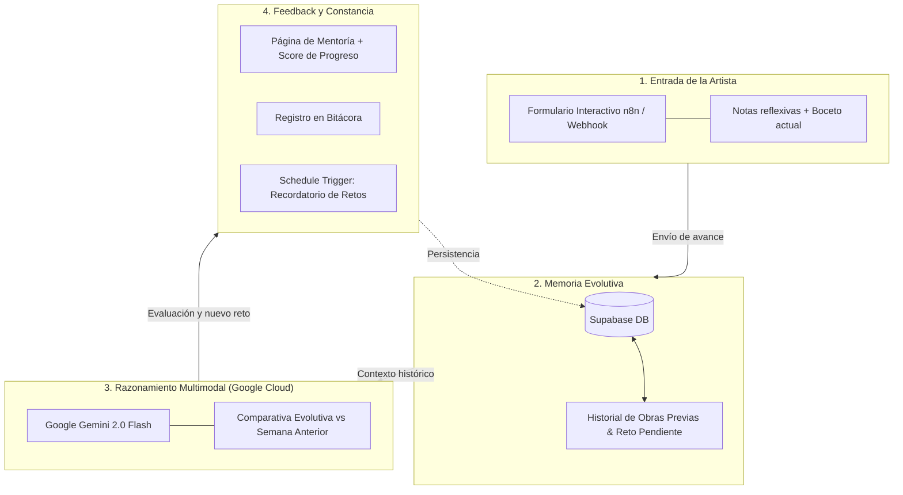

# 🎨 Musa Studio · Mentoría Creativa con IA y Memoria Evolutiva

> **Nodo Cero · Hackathon n8n Bolivia 2026**  
> *Sede: Centro de Educación Ambiental (CEA), Santa Cruz de la Sierra*  
> **Línea:** IA para tu comunidad | **Postulación:** Mención Especial *Mejor uso de Google Cloud*

---

## 💡 El Problema
Miles de jóvenes artistas y creadoras (de 15 a 30 años) practican dibujo, pintura e ilustración en soledad. Sin una retroalimentación técnica constructiva ni un registro organizado de sus avances anteriores, pierden la noción de cuánto han progresado, experimentan frustración y terminan abandonando sus metas creativas.

## ✨ La Solución
**Musa Studio** es un espacio privado de mentoría artística impulsado por **n8n** y **Google Gemini**. A diferencia de un asistente de chat genérico, Musa cuenta con **memoria evolutiva**:
1. Recibe la nueva obra o boceto de la artista junto a sus reflexiones personales.
2. Consulta en **Supabase** el historial de obras y retos previos.
3. Evalúa la evolución técnica respecto al trabajo anterior (proporciones, sombreado, volumen).
4. Celebra logros concretos, brinda 2 recomendaciones prácticas para su próxima sesión y le asigna su **siguiente reto creativo**.
5. Dispara **recordatorios de constancia programados** para asegurar el hábito diario o semanal.

---

## 🏗️ Arquitectura de la Solución

---

## 📦 Workflows incluidos en este Repositorio

Los workflows se encuentran listos para importar en la carpeta [`workflows/`](workflows/):

| Archivo | Nombre | Disparador | Qué hace |
| :--- | :--- | :--- | :--- |
| [`01_musa_mentoria_evolutiva.json`](workflows/01_musa_mentoria_evolutiva.json) | **Mentoría Creativa Evolutiva** | Formulario n8n / Manual | Flujo principal: recibe el avance, carga la obra previa de Supabase, evalúa con Gemini y entrega feedback con reto. |
| [`02_musa_recordatorios_retos.json`](workflows/02_musa_recordatorios_retos.json) | **Recordatorios de Constancia** | Schedule (Lunes y Jueves) | Monitorea retos activos por vencer y redacta recordatorios cálidos para evitar el abandono. |
| [`03_musa_api_portafolio.json`](workflows/03_musa_api_portafolio.json) | **API de Portafolio Evolutivo** | Webhook GET | Expone la línea de tiempo de la creadora en JSON para apps frontend o paneles de usuaria. |

---

## 🗄️ Base de Datos (Supabase)

En la carpeta [`supabase/`](supabase/) se encuentran los scripts SQL para reproducir el entorno:
* [`supabase/schema.sql`](supabase/schema.sql): Tablas de `perfiles`, `obras` y `retos` con llaves foráneas y políticas RLS.
* [`supabase/seed_demo.sql`](supabase/seed_demo.sql): Datos precargados de **Camila Vargas** (Semana 1 vs Semana 2) para realizar la demo en vivo.

---

## 🚀 Cómo Importar y Ejecutar en n8n

Sigue la guía rápida en [`docs/GUIA_IMPORTACION_N8N.md`](docs/GUIA_IMPORTACION_N8N.md):
1. Copia el contenido del JSON del workflow (`Ctrl + A`, `Ctrl + C`).
2. En tu n8n, presiona **`Ctrl + V`** sobre el lienzo en blanco.
3. Conecta tu credencial de **Google Gemini API** (Google AI Studio gratuita o Vertex AI).
4. Haz clic en **Execute workflow** o prueba el botón **Al tocar Execute (Demo rápida)**.

---

## 🎯 Caso de Demostración para el Jurado

* **Artista:** Camila Vargas (19 años, Santa Cruz).
* **Semana 1:** Sube su primer boceto de rostro en 3/4. Su mentora Musa le detecta asimetría en los ojos, le enseña a usar líneas guía y le propone el reto de practicar 3 pares de ojos en perspectiva.
* **Semana 2 (Demo en Vivo):** Camila sube su nuevo avance aplicando el lápiz 4B y líneas de horizonte. Musa compara ambos trabajos, detecta la resolución del problema y le otorga un **+22% de progreso técnico**, felicitándola y activando el siguiente reto de brillos y luces.

---

## 👥 Equipo y Créditos
* **Equipo:** Musa Studio Team
* **Repositorio:** [github.com/Jael-S/musa-studio-n8n](https://github.com/Jael-S/musa-studio-n8n)
* Desarrollado en la Hackathon **Nodo Cero Bolivia 2026**.
