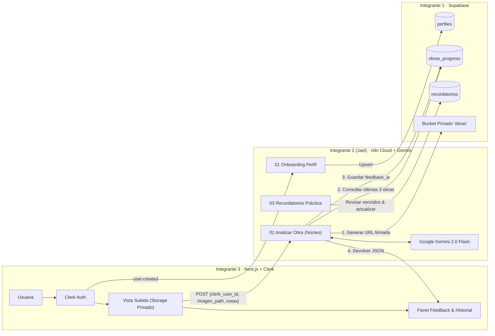

# 🎨 Musa Studio · Mentoría Creativa con IA y Memoria Evolutiva

> **Nodo Cero · Hackathon n8n Bolivia 2026**  
> *Sede: Centro de Educación Ambiental (CEA), Santa Cruz de la Sierra*  
> **Línea:** IA para tu comunidad | **Postulación:** Mención Especial *Mejor uso de Google Cloud*

---

## 💡 El Problema
Miles de jóvenes artistas y creadoras (de 15 a 30 años) practican dibujo, pintura e ilustración en soledad. Sin una retroalimentación técnica constructiva ni un registro organizado de sus avances anteriores, pierden la noción de cuánto han progresado, experimentan frustración y terminan abandonando sus metas creativas.

## ✨ La Solución
**Musa Studio** es un espacio privado de mentoría artística impulsado por **n8n**, **Google Gemini** y **Supabase**. A diferencia de un asistente genérico, Musa cuenta con **memoria evolutiva**:
1. La usuaria inicia sesión con **Clerk** y gestiona su perfil y metas artísticas.
2. Sube sus obras o bocetos al bucket privado de **Supabase Storage** con sus notas reflexivas.
3. El backend en **n8n** genera una URL firmada temporal, extrae el historial de las últimas 3 obras y llama a **Google Gemini Vision**.
4. Gemini devuelve un JSON estructurado con:
   * **Aciertos:** Aspectos técnicos positivos del avance.
   * **Consejo Técnico:** Recomendación práctica para su próxima sesión.
   * **Comparación:** Evaluación del progreso frente a la obra y reto anterior.
   * **Siguiente Reto:** Meta creativa para los próximos días.
   * **Mensaje:** Palabras de aliento de su mentora.
5. El resultado se almacena en `obras_progreso` y se dispara un sistema de recordatorios periódicos.

---

## 🏗️ Arquitectura del Sistema (División del Equipo)

---

## 📦 Workflows de n8n (Integrante 2 - Jael)

Ubicados en la carpeta [`workflows/`](workflows/):

| Archivo | Endpoint / Trigger | Entrada / Salida |
| :--- | :--- | :--- |
| [`01-onboarding-perfil.json`](workflows/01-onboarding-perfil.json) | Webhook POST `/webhook/clerk-onboarding` | Recibe `user.created` de Clerk y crea el registro en la tabla `perfiles`. |
| [`02-analizar-obra.json`](workflows/02-analizar-obra.json) | Webhook POST `/webhook/analizar-obra` | **Núcleo con IA:** Recibe `{ clerk_user_id, imagen_path, notas_usuaria }`, firma la URL en Storage, consulta las últimas 3 obras, evalúa con Gemini y responde el JSON a Next.js. |
| [`03-recordatorios-practica.json`](workflows/03-recordatorios-practica.json) | Schedule Trigger (Cada 4 horas) | Busca recordatorios vencidos en `recordatorios`, genera un tip con Gemini y actualiza `proxima_fecha`. |

---

## 🗄️ Esquema de Base de Datos (Integrante 1 - Supabase)

Ubicados en [`supabase/`](supabase/):
* [`supabase/schema.sql`](supabase/schema.sql):
  * `perfiles (clerk_user_id, nombre, disciplina, meta_actual, created_at)`
  * `obras_progreso (id, clerk_user_id, imagen_path, notas_usuaria, feedback_ia, created_at)`
  * `recordatorios (id, clerk_user_id, proxima_fecha, frecuencia, activo)`
  * Bucket privado `obras` en Supabase Storage.
* [`supabase/seed_demo.sql`](supabase/seed_demo.sql): Datos de prueba de **Camila Vargas** (Semana 1 y Semana 2) con feedback previo para demostrar la memoria evolutiva en vivo.

---

## 🎤 Minutero de Presentación (15:00)

* **[0:00 - 0:40] Integrante 1 (Supabase):** Explica el problema y la solución de Musa Studio.
* **[0:40 - 1:50] Integrante 3 (Next.js):** Muestra en vivo el login con Clerk, la subida de la obra al bucket privado y la recepción del feedback con memoria en el panel.
* **[1:50 - 2:35] Integrante 2 (Jael - n8n):** Muestra en vivo en su pantalla el canvas de n8n, la firma de la URL privada, la consulta de memoria y la llamada a Gemini Vision.
* **[2:35 - 3:00] Integrante 1 (Supabase):** Cierra explicando la memoria histórica, los recordatorios y la postulación a la mención **Mejor uso de Google Cloud**.

---

## 👥 Equipo
* **Integrante 1:** Supabase (Base de Datos y Storage Privado)
* **Integrante 2 (Jael - @Jael-S):** n8n Cloud + Google Gemini (Backend y Automatizaciones)
* **Integrante 3:** Next.js + Clerk (Frontend y Autenticación)
* **Repositorio:** [github.com/Jael-S/musa-studio-n8n](https://github.com/Jael-S/musa-studio-n8n)
